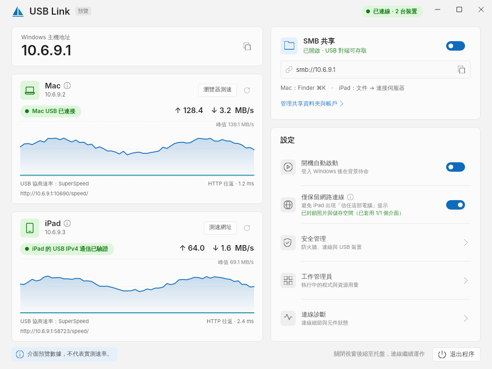

# USB Link

**English** | [简体中文](README.zh-CN.md)

**Connect an Apple Mac or iPad to Windows over a USB Type-C data cable, without an Ethernet cable.**

USB Link turns the USB connection into a usable network. Once connected, devices can use SMB file sharing and other configured, authorized LAN applications over that network.

## Features

- **Direct USB networking**: connect supported Macs and iPads to Windows and prepare the network interface and addresses.
- **SMB management**: manage shared folders, accounts and access permissions on Windows. Connect using Finder on Mac or the built-in Files app on iPad.
- **Connection management**: view devices, authorization and traffic, and clean up network settings owned by USB Link on disconnect.

## Screenshot



Current application UI preview. Devices, traffic and speeds use example data; this is not a hardware benchmark.

## Components to prepare

These components are for the **Windows x64 host**. Prepare only those required by the devices you use. Let USB Link check existing components first; a full reinstall is unnecessary.

| Component | Purpose and when needed | Reusing an existing installation | Official download |
| --- | --- | --- | --- |
| .NET 10 Runtime (x64) | Desktop interface; end users do not need the SDK | Reuses a system installation containing `Microsoft.NETCore.App 10.x`; .NET 8/9 alone or an x86 installation does not satisfy this check | [Microsoft downloads](https://dotnet.microsoft.com/en-us/download/dotnet/10.0) |
| Apple Mobile Device Support / Service | Windows-to-iPad communication; unnecessary for Mac-only connections | Checks the existing Apple communication service first; do not uninstall iTunes or other Apple software preemptively | [Apple iTunes for Windows](https://www.apple.com/itunes/) |
| Apple USB driver | Windows recognition and connection of iPad | Skips installation when the target device already has the required driver binding; otherwise checks and prepares it | [Microsoft Update Catalog](https://www.catalog.update.microsoft.com/Search.aspx?q=Apple%20Mobile%20Device) |
| Wintun 0.14.1 (AMD64) | Windows virtual network adapter for Mac connections and the iPad shared-host path | Official signed archive included; reuses an actually verified compatible DLL | [Wintun](https://www.wintun.net/) |
| Zadig 2.9 | Preparing WinUSB bindings for Mac USB interfaces when needed | Unnecessary when those interfaces already use WinUSB; downloading the tool alone does not bind a driver | [Zadig](https://zadig.akeo.ie/) |
| Windows WinUSB, SMB and other OS components | USB device access, file sharing and network management | Provided by Windows, with no separate download; SMB still needs accounts, folders and permissions configured | Included with Windows |

The [component preparation guide](docs/DEPENDENCIES.md) provides direct official downloads for pinned versions, existing-installation checks and preparation before going offline. SMB access on Mac/iPad uses Finder/Files without an additional SMB client.

## Getting started

1. Connect your Mac or iPad to Windows with a USB Type-C cable that supports data transfer.
2. Run USB Link as administrator on Windows. Follow the prompts to prepare required components and authorize the device.
3. Wait for the connected device and its network address to appear. Device and USB interface support depends on the actual hardware detected.
4. To share files, add folders and configure accounts and permissions in “SMB 共享” (SMB sharing), then use the connection address shown:
   - **Mac**: Finder → Go → Connect to Server (⌘K).
   - **iPad**: Files → Browse → More (…) → Connect to Server.

SMB and other applications still need their services, accounts and firewall permissions configured. A direct USB network does not automatically share Internet access; Windows → Mac Internet sharing is a separate, optional feature and starts off.

For throughput measurement, select **瀏覽器測速** in the Windows Mac card and open the displayed URL in the Mac browser. Start the test on that page; no Mac measurement program or script is required. Results include browser overhead.

## Status

See [VERSION](VERSION). This is a preview: **Windows/Mac/iPad hardware acceptance is still pending**. Successful builds and automated tests do not establish support for every device. See [validation](docs/VALIDATION.md).

## Build from source

Install Go 1.26, .NET SDK 10.0.100 and Python 3.9 or newer:

```sh
python3 scripts/project.py setup
python3 scripts/project.py check
python3 scripts/project.py package
```

Outputs in `out/` include an unsigned Windows launcher, Mac network helper tools, a source archive and checksums. Building requires network access to restore Go/NuGet dependencies. External drivers, Apple installers and the .NET runtime are not bundled with source or release packages; see [dependencies](docs/DEPENDENCIES.md).

## More information

- [Building](docs/BUILDING.md)
- [Workspace and GitHub synchronization](docs/WORKSPACE.md)
- [Architecture](docs/ARCHITECTURE.md)
- [Internet sharing](docs/INTERNET-SHARING.md)
- [Contributing](CONTRIBUTING.md) · [Security](SECURITY.md)

Original code is licensed under [GPL-3.0-only](LICENSE), with the narrowly scoped [official Wintun DLL linking exception](LICENSE-WINTUN-EXCEPTION). Third-party code retains its own licenses; see [notices](licenses/THIRD-PARTY.txt).

Windows installation layout and lifecycle: [installation specification](docs/INSTALLATION-LIFECYCLE.zh-CN.md).
