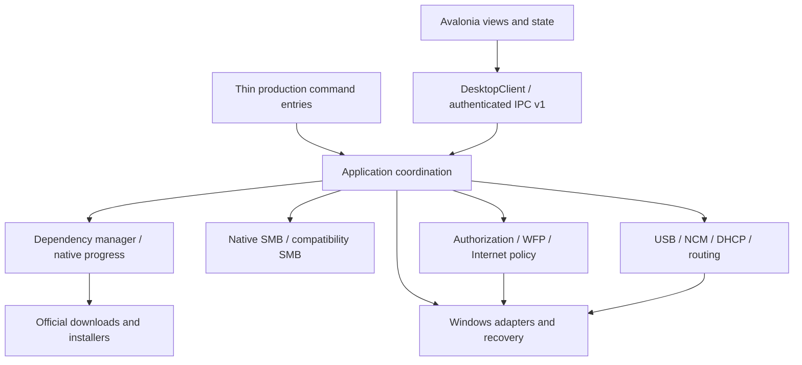

# Architecture

One repository, one Go module, Avalonia desktop rendering. The module name `suhang/usbnet`, service names, product markers, address profiles, upgrade verification keys and recovery journal formats are compatibility identities, not branding to rename during this migration.

| Directory | Responsibility |
| --- | --- |
| `cmd/` | Production argument/start entry wrappers; diagnostic command tools |
| `internal/dependencies` | Pinned official catalog, detection, bounded downloads, verification, native progress and platform installation |
| `internal/app` | Lifecycle, connection coordination, upgrades, installation and recovery orchestration |
| `internal/transport` | WinUSB/Wintun, NCM packets, DHCP, point-to-point addresses and routing admission |
| `internal/sharing` | SMB folder/account policy, compatibility SMB, network diagnostics and protocol helpers |
| `internal/security` | Device/application authorization, USB WFP scope, native Internet backend |
| `internal/platform/windows` | Native Windows APIs, network configuration, service/driver adaptation |
| `internal/contracts` | Authenticated IPC v1 request/response contract |
| `internal/diagnostics` | Bounded measurements and read-only evidence |
| `desktop/App`, `Views`, `Models`, `Controls`, `Theme`, `Services`, `Tests` | Application entry, UI composition, typed snapshot state, components, style, service client/native read-only helpers, synthetic smoke checks |

`architecture-map.json` records every original package path and its new owner. Package names remain stable; imports were updated together. Production commands for launcher, bridge worker, Mac agent contain no business implementations. Their implementations now belong to application modules. The desktop's original single-file classes are separated without changing their controls; outbound intent goes through one synchronized `DesktopClient` writer.

Device display fields are defined in `internal/contracts/desktopipc`. The Go
snapshot keeps the existing JSON names and legacy top-level device fields.
`desktop/Models/DeviceStatus.cs` parses current two-device and older single-device
messages once; `DeviceStatusView` receives that model and intent/copy callbacks,
without accessing the dashboard or parsing JSON. Transport activity and verified
peer connectivity remain separate fields. Shared fixtures check Go output and
C# interpretation, including stale-slot removal and shutdown.

Policy and native mutation have separate boundaries: `dependencies.Platform` controls detect/verify/install; `internet.Backend` controls preflight/journal/create/open/close/readback. Routing policy contains no system calls. Existing Windows implementations remain separated by build tags from pure policy/tests. Go's compiler rejects package cycles, and `scripts/check_architecture.py` checks ownership and lower-layer imports. Integration tests may import application fixtures without changing production dependencies.

## Native SMB and compatibility SMB

Native SMB uses Windows' service, account and folder ACL APIs on port 445. Compatibility SMB stays in `internal/sharing/smbcore` on port 10690 with its original MIT provenance and local security changes. Their authority, account lifecycle, directory access checks, diagnostics and acceptance are separate. Neither a successful compatibility test nor a mount from retained history proves native SMB acceptance.

## IPC and authority

IPC remains v1. Snapshot's existing display gains `dependencies` and `internet_sharing`; action gains dependency refresh and `internet-enable`, `internet-disable`, `internet-refresh`. An elevated owner UI is independently authenticated by the existing pipe server. The core rechecks live Mac/host identity before mutation and again before publication. The renderer never supplies executable paths, PowerShell or filesystem locations.

Official installers that need visible license acceptance run in the authenticated interactive launcher/UI, rather than in the service's noninteractive session. Dependency-install intent is validated against the fixed catalog. Subsequent core refresh detects the actual installed state.

## Recovery

Existing protected journals retain their format. Internet sharing adds a separate protected journal, a five-second session lease and bounded traffic observation. The journal precedes NAT or forwarding mutation. WFP keys are added to the existing gateway recovery journals before installation. On failure, shutdown or loss of identity, packet admission closes first, then DNS/WFP/NAT are removed and forwarding is restored. Unproven cleanup keeps its journal and blocks another enable attempt.

The worker receives a parent-selected Mac attachment identity, reads only the product-owned protected lease and checks the expiry per packet. Lease expiry gives fail-closed behavior even if the core terminates before normal cleanup. Startup recovery removes the recorded NAT; it never restores a prior enabled-sharing preference.

## Release scope

Temporary file transfer and developer remote-upgrade entry points have been removed; see [release boundaries](RELEASE-SCOPE.md). Local installation and rollback compatibility retain their protected journals.

## Local Windows installation

`connectioninstall` coordinates a durable local transaction around the existing authenticated SCM lifecycle. Publisher content is staged and independently verified before quiescing; the stable executable and desktop live in `Program Files/USB Link/App`. Machine settings, security and transactions use ProgramData. A stopped service temporarily references a verified backup during replacement, then an authenticated SYSTEM initialization record permits cleanup. Core background cleanup cannot retire legacy sources while this local transaction remains unfinished. Uninstall closes authenticated login clients before restoring owned hardware/network state and removing files. See [lifecycle specification](INSTALLATION-LIFECYCLE.zh-CN.md).

### Desktop snapshot history budget

The service-to-desktop projection sends current connection values and performance aggregates, not the core's per-second history or fault-event arrays. Full histories remain in core diagnostics; projected `older_samples_omitted` includes samples excluded from the desktop snapshot. This keeps session duration from exhausting the 48 KiB display snapshot budget. A regression fixture with a full 600-sample ring and 64 fault events exceeds the old limit and verifies identical rendered device status after projection.

A failed service read produces a bounded `backend-unavailable` event with a fixed error code. The renderer marks existing values stale and disables business controls while retaining exit controls; only a normal version-bearing status clears that state. The core snapshot's status and encoded byte count are included in USB diagnostics. Missing status is never treated as successful version verification.
